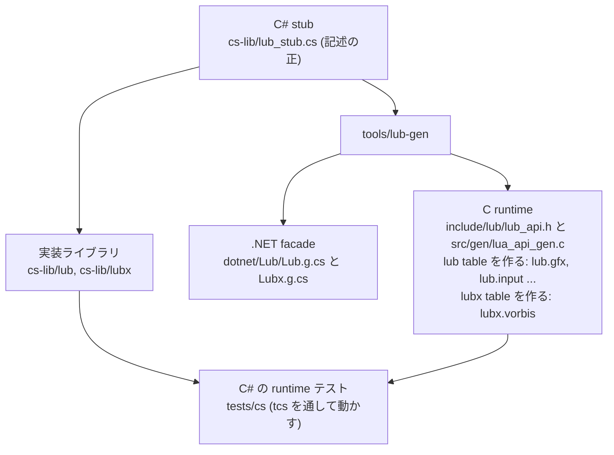

# API glue — 多言語 authoring の接合部

lub のゲームは TinyC# で書く。tcs の出力と .NET 実行が同じ runtime API
面を見るための接合部と、その上の実装ライブラリの供給方針をまとめる。
記述の正は C# stub(`docs/log/2026-09-04-language-architecture-design.md`)。

## 層構成



- contract 層 — 生成した Lua binding(`src/gen/lua_api_gen.c`)が `lub` table を作る。小文字の namespace(`lub.gfx.begin_pass`)が tcs の出力の見る内部の面で、利用者にも開発者にも開かない。.NET 実行は同じ記述から生成した facade(`dotnet/Lub/Lub.g.cs`)が C API(`include/lub/lub_api.h`)を P/Invoke する。
- binding 層 — C# stub は API 面の記述そのもので、実装を持たない。tcs が
  名前を規則で Lua に写す。
- 実装ライブラリ層 — サンプルの一部という位置付けのコード。ユーザーが
  読み、hot reload で書き換えられることが lub の価値なので、runtime への
  Lua 供給はせず C# で実装する(`cs-lib/`)。
- lubx の C の面 — lubx が C のライブラリを使うとき(Ogg Vorbis の decode など)は、stub の末尾の `namespace Lubx` に宣言し、`src/lubx/` に C で実装する。
  core API ではない(runtime が守る不変条件のためのものではない)ので namespace を分ける。
  Lua では `lubx` table(`lubx.vorbis.decode`)、C では `lubx_` の名前(`lubx_vorbis_decode`)、.NET 実行では `dotnet/Lub/Lubx.g.cs` になる。
  `namespace Lubx` には static class だけを置き、型と enum は `Lub` のものを使う。

## tcs2c 実行

同じ C# ソースを `tcs2c --lib --ref cs-lib/lub_stub.cs` で C に変換できる。
release の一式の `bin/tcs/tcs c` も同じ引数で同じ C を出す (tcs2c は `tcs c` を .NET で動かす入口)。
`lub-gen tcs --source Game.cs --source Other.cs -o binding.c` に同じソースを渡すと、
使用する API の C 接続コードを stub から生成する。対応していない型は生成時にエラーにする。
record に置く callback (`WorldCallbacks` の `Filter` など) は未対応で、値を入れると実行時に
`lub-callback-field` で止まる。関数の `Func` 引数 (`Phys2d.RaycastAll` の visitor など) は使える。
生成したゲームの後に接続コードを include し、native は `liblub` にリンクする。

native の `lub Game.csproj` は `src/tcs_build.c` が cs-lib の実装ソースをゲームの後ろに
足す。tcs2c では入力に自分で足す。足さないと `using Lubx;` が解決できず止まる。

- 入力は、ゲームのソースに続けて `cs-lib/lub/*.cs` と `cs-lib/lubx/*.cs`
  (`lub_stub.cs` は `--ref` で渡すので含めない)
- 同じ並びを `tcs2c` と `lub-gen tcs` の両方に渡す
- 並びは native と同じく、ゲームの後に cs-lib。static 初期化子の順は tcs が型の
  依存から決めるので、ゲームの static 初期化子から cs-lib を参照してよい

```sh
sources=(Game.cs cs-lib/lub/*.cs cs-lib/lubx/*.cs)
args=(); for f in "${sources[@]}"; do args+=(--source "$f"); done
dotnet tcs2c.dll --lib --ref cs-lib/lub_stub.cs "${sources[@]}" -o game.c
dotnet lub-gen.dll tcs --stub cs-lib/lub_stub.cs "${args[@]}" -o binding.c
```

release の一式では、dotnet の代わりに `bin/tcs/tcs c` と `bin/tcs/lub-gen tcs` に同じ引数を渡す。

`scripts/verify-tcs-binding.sh` が、cs-lib 全体をこの経路で生成して compile できることを確かめる。

`src/tcs_host.c` は entry class の `OnInit` / `OnFrame` / `OnEvent` / `OnQuit` を呼ぶホスト。
entry class は static な `OnFrame(float)` を持つ class で、`lub-gen tcs --entry CLASS`
(namespace 付きは `MyGame.Game`)で指定する。省略すると、そういう class が唯一のときに
それを使う。`lub-gen tcs` がその class の hook を `tcs_entry_<Class>_*` に繋ぐ接続コードを
出し、定義の無い `OnInit` / `OnEvent` / `OnQuit` は何もしない。`OnEvent` は `static void OnEvent(EventData)` でなければ `lub-gen tcs` が error にする。
ホストは frame の前に溜まった event を `OnEvent` に渡す。Quit の event を受けたら残りの event は渡さず、Quit の event を受けた frame と `OnEvent` が `App.Quit` を呼んだ frame は回さずに `OnQuit` へ進む(Lua のホストと .NET 実行と同じ)。
CMake の `LUB_TCS_GAME` と `LUB_TCS_BINDING` に生成ファイルを指定すると、
通常の Lua ホストに代えて使う。C コンパイラーは GCC または Clang が必要。
Web は Emscripten で同じ C を Wasm に変換する。
Web の page が player を外すと `OnQuit` は呼ばれないので、page は外す前に `Module._lub_tcs_shutdown()` を呼ぶ。
これはループを止め、`OnQuit` を走らせてから runtime を解放する。`OnQuit` の中の `Host.Send` は同期で page に届く。
2 回目以降の呼び出しと、`OnQuit` の中から (page が message を受けてその場で) の呼び出しは何もしない。

## 名前の規則

C# の名前が中立表記で、Lua と C の名前は規則で導く(例外表は持たない)。

| 面 | 例 | 規則 |
| --- | --- | --- |
| C# | `Gfx.BeginPass`, `Gfx.PixelFormat.Rgba8`, `Phys2d.World` | 通常の C# 命名(PascalCase) |
| Lua | `lub.gfx.begin_pass`, `lub.gfx.RGBA8`, `lub.phys2d.world` | 先頭を小文字にし、大文字の前に `_` を入れて小文字化。enum メンバは全大文字。namespace は全小文字 |
| C | `lub_gfx_begin_pass`, `LUB_GFX_PIXEL_FORMAT_RGBA8` | `lub_` + namespace + snake_case。enum は `LUB_` + namespace + enum 名 + メンバの全大文字 |

写像は tcs の emit が行う(tcs `doc/support-matrix.md` の「Lua 出力の
名前規則」)。C# 側は `cs-lib/lub_stub.cs` の namespace `Lub` に static class
(`Gfx`, `Input`, `App`, ...)と enum を置き、ゲームは
`using Lub;` で `Gfx.BeginPass(...)` と書く。entry callback は
`OnInit` / `OnEvent` / `OnFrame` / `OnQuit` で、player も Lua の出力から同じ名前で引く。

## tcs VM 実行

同じ C# ソースを `tcs vm` で tcs VM の bytecode (`.tcsb`) にし、`lub_vm` (`src/vm_player.c`) で動かせる。
`scripts/run-cs-sample.sh <sample> --vm` が `samples/<sample>/.lub/<Entry>.tcsb` を作る
(入力は tcs2c 実行と同じく、ゲームの後に cs-lib。entry class の static method を `--export <Entry>.*` で出す)。

```sh
lub_vm samples/09_breakout/.lub/Breakout09.tcsb --entry Breakout09
```

API は `lub-gen vm` が stub の全部の関数を tcs VM の host の関数 (`tvm_host`) にした `src/gen/vm_api_gen.c` で、
player はゲームを選ばない。変換の規則は tcs2c の接続コードと同じで、record は VM の object の layout を写した C の struct
(`VmLub_<型>`) で読み書きする。layout は読み込みと reload の後に VM の型の表と突き合わせる。
tcs2c が process を止める誤り (配列の長さ、bit mask) は、その呼び出しの VM の fault (C# の trace 付き) になる。
`lub-gen vm --source Game.cs` はそのゲームが使う関数だけを出す (`scripts/verify-vm-binding.sh` が偽の C API で使う)。

hot reload は `<Entry>.batch` (tcs vm の差分。`tvm_apply_batch` で当てる) で、当てられない編集と `.tcsb` の書き直しは
`OnQuit` の後に新しい VM で `OnInit` から始める。`<Entry>.rev` があれば、読み込みと batch の後に Lua の player と同じ形の
commit ACK (`@@tcs_commit {"revision":N,"ok":...}`) を出す。
playground は `?runtime=vm` でこの player (`build/wasm/vm/lub.js`) を使い、変換は tcs の wasm の VM の session (`vmopen` / `vmupdate`)。

`lub_vm Game.csproj` は Lua の `lub Game.csproj` と同じ入力 (csproj のディレクトリと `Lub="Source"` / `Lub="Overlay"` の参照先の下の `*.cs`、cs-lib の実装。`*.ref.cs` は `--ref`) の一覧を `.lub/<Entry>.inputs` に書き、`tcs vm --watch --inputs-from` を背後に張る (`src/vm_project.c`)。
一覧は 0.3 秒ごとに探し直すので、file を足すか消すとそのまま変換し直す。
差分は `@@tcs_vm_batch` の frame で届き、当ててから entry と overlay の `OnReload` を呼ぶ。
compile error は `@@tcs_build_failed` の frame で届き、`OnBuildFailed(errors)` に渡す。
`Lub="Overlay"` の参照先の class は overlay として、`OnInit` はゲームの後、`OnEvent` はゲームの前、`OnFrame` はゲームの後、`OnQuit` はゲームの前に呼ぶ (`.tcsb` から動かすときは `--overlay CLASS`)。
overlay があると、overlay の参照先を除いたソースのディレクトリを `tcs vm --trace` にし、`Sys.TakeTrace` / `TakeValues` / `Inspect*`、`Rewind`、`Gfx.Pick` の呼び出し元を VM から読む (tcs の `tcsvm.h` の検査の口)。
Lua の player はこれらの口を持たず、空を返す。
ゲームのソースのディレクトリの `X.ref.cs` の隣に native の library (`X.so` / `X.dylib` / `X.dll`、無ければ `libX.*`) を置くと、`lub_vm` はそれを native の拡張として読み、VM を作るたびに `lub_vm_extension` を呼んで、`X.ref.cs` の関数を VM の host の関数として登録させる (`include/lub/lub_vm_extension.h`。拡張は lub の symbol を使わず、渡した表の関数だけを使う)。
`.tcsb` から動かすときは `--extension LIB` で渡す。
player は library (`lub_vm_player`、`include/lub/lub_vm.h`) で、既製の `lub_vm` はそれに数行の main (`src/vm_main.c`) を付けたもの。
自前の player は、lub を CMake の `add_subdirectory` で取り込み、自分の main (`include/lub/lub_vm_main.h` の `LUB_VM_MAIN`) で native の拡張を静的に link する (web で native の拡張を使うのはこの形だけ)。
web の実行物の設定は `lub_vm_player_link_options(<target> <出力のディレクトリ>)` が付ける。
`scripts/vm-project-test.sh` が `tests/vm/` の project で確かめる。
native gate は全サンプルで、tcs VM の player の digest と capture が tcs→Lua と一致することを確かめる。

## 各層の対応

| 層 | 場所 |
| --- | --- |
| binding(宣言のみ) | `cs-lib/lub_stub.cs`。PascalCase で宣言し tcs が snake_case に写す |
| 実装ライブラリ | `cs-lib/` に TinyC# で実装(サンプルや test と一緒に transpile) |
| API reference | stub の XML doc から生成(`scripts/gen-api.sh` → `web/gen/lub-api-docs.json`) |

## 新 API を足す手順

1. `cs-lib/lub_stub.cs` の `Lub` の下に PascalCase で宣言 + doc comment。
   stub の class も継承を持たない (TinyC# と同じ。`lub-gen` が止める)。
   共通の field は各 class に書き、別の型として受け渡す部分は field に持つ (`GltfMesh.Mesh` を `Io.InterleavePn` に渡すなど)
2. `scripts/gen-api.sh` で header / Lua binding / API docs / facade を再生成
3. C runtime に `include/lub/lub_api.h` の関数を実装(`src/`)
4. 実装ライブラリの機能なら `cs-lib/` に TinyC# で実装する

## 接点ファイル

| ファイル | 役割 |
| --- | --- |
| `cs-lib/lub_stub.cs` | C# binding 宣言 = API 面の記述 |
| `cs-lib/` | 実装ライブラリ |
| `web/playground/tcs-worker.ts` | playground が stub を fetch し `--ref` 相当で渡す |
| `scripts/run-cs-sample.sh` | CLI 外での check / build |
| `tools/lub-gen/` | stub を記述として読む generator。`check`(名前の規則・衝突)、`model`(JSON)、`header`(`include/lub/lub_api.h`)、`lua`(`src/gen/lua_api_gen.c`)、`facade`(`dotnet/Lub/Lub.g.cs`、.NET 実行の P/Invoke)、`facade-lubx`(`dotnet/Lub/Lubx.g.cs`)、`docs`(`web/gen/lub-api-docs.json`)、`tcs`(tcs2c 実行の接続コード)、`vm`(`src/gen/vm_api_gen.c`、tcs VM の host の関数)。まとめて `scripts/gen-api.sh`。本体は TinyC# で、stub とゲームは tcs の compiler(`third_party/tcs/SelfHost/Compiler`)で読む。.NET では `tools/lub-gen/lub-gen.csproj`(`host/Program.cs` が入口)、C では `scripts/build-lub-gen.sh` が tcs の compiler と一緒に `tcs c` で C にした `<build-dir>/tcs/lub-gen`(dotnet は要らない)。どちらも同じ出力を出す |

## cs-lib 実装モジュールの供給規約

`cs-lib/` 配下の `*.cs` のうち `lub_stub.cs` だけが `--ref`(宣言のみ、emit されない)。
それ以外は実装ソースとして全 C# サンプルのコンパイル入力に一律追加される
(lub CLI / `run-cs-sample.sh` / playground の 3 箇所とも。サンプル側での選択はしない)。
配置は `cs-lib/lub/<Name>.cs` / `cs-lib/lubx/<Name>.cs` で、namespace はそれぞれ `Lub` / `Lubx`(ゲームは `using Lubx;` で使う。IDE 用の csproj は両ディレクトリを Compile Include する)。
