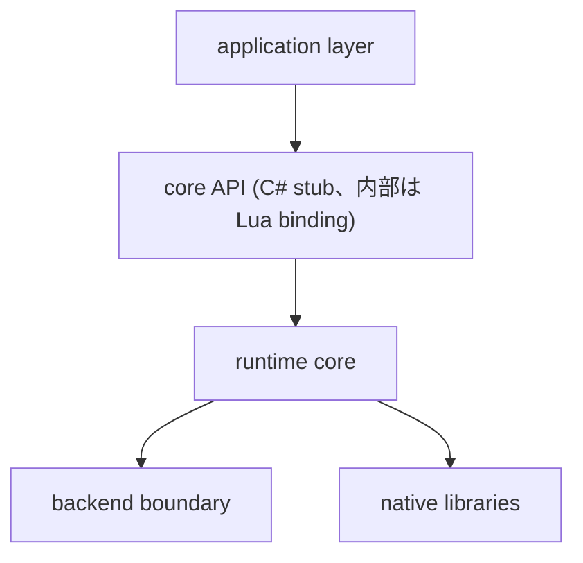

# lub Design

lub は、細部までこだわったゲーム体験を作るためのコード中心のゲームエンジンである。
最重要の価値は、ゲームを止めずに変更を反映し、トライアンドエラーを極限まで速くすること。

## Why

AI が自動生成する平均的な体験ではなく、人間が細部まで調整しきった体験を作れる環境がほしい。
そのためには、asset、描画、入力、物理、音、診断情報をコードから直接制御でき、変更が即座に動作へ反映される必要がある。

lub は GUI editor や特定 asset pipeline を中心に据えず、開発者が自分のゲームに必要なデータ構造と workflow をコードで組める余地を残す。

## To Be

- ゲームをコード中心に組み立てられる。
- 実行中のゲームを止めずに、コードや asset の変更を即座に反映できる。
- runtime 基盤は C/C++ と既存ライブラリを再利用し、移植性と native integration を保つ。
- ゲームは C# (TinyC#) だけで書く。Lua は tcs の出力と runtime の間の内部の層で、利用者にも開発者にも開かない。
- 3D graphics を標準の描画基盤として持ち、2D game もその上で自然に扱える。
- core API は最小の固い primitive に絞る。
- core API の外側は C# の実装ライブラリ (`cs-lib/`) と app code が担う。lubx は C のライブラリが要るところだけ C の実装 (`src/lubx/`、stub の `namespace Lubx`) を持つ。

内部の層に Lua を使う理由として、reload 時に data shape の変化へ追従しやすいことを重視する。
C# はその性質を活かしたまま、より書きやすい script authoring を提供するために使う。

script authoring layer は TinyC#
([tcs](https://github.com/neguse/tcs)、C# サブセット → Lua transpiler)。
全サンプルを C# で提供する (一覧の正は `web/playground/samples.ts` の
CS_SAMPLES)。web playground と native CLI
(`lub <sample>/<Entry>.csproj`) は同じ DX (build + watch + hotswap) を持ち、
player・Lua API 面 (生成 binding)・hot reload セマンティクスを共有する。
csproj は IDE 用の実プロジェクトでもあり、lub は basename (= entry class)
しか読まない。

C# のゲームは 2 つの実行形で動く。tcs→Lua (lub の player が hotswap で
動かす dev の経路) と .NET 実行 (実 .NET が `dotnet/Lub` の facade から
共有 library の C API を P/Invoke で叩く経路、host は `App.Run(typeof(Game), args)`)。
同じソースが両方で通ることが契約で、CI は各サンプルを両方で headless に
回し、frame ごとの digest (C API 呼び出しの構造の hash) を突き合わせる。
数値は両方 f32 で、Math の超越関数も同じ実装 (次の段落) なので絵も揃い、手元の gate では capture 同士を byte 比較する。CI の契約は digest だけ。
golden 画像は tcs→Lua の分 (`tests/golden/<name>_<backend>.png`) だけを持つ。

ゲームの論理の計算は OS をまたいで決定的にする。数値は f32 で、四則演算と sqrt / floor / fmod などは IEEE-754 で結果が決まる。結果が実装で変わる超越関数 (sin / cos / tan / atan2 / exp / log / pow) は tcs が 1 つの実装 (`third_party/tcs/runtime/math`、三角関数系と log10 は CORE-MATH、exp / log / log2 / pow は musl の Arm 由来) を持つ。tcs2c の生成 C はそれを埋め込み、tcs の Lua 出力は lub が VM に登録する `tcs_math` を呼び、.NET 実行は TinySystem.Math (同じ手順の C# 版) を呼ぶ。.NET の project は tcs の `TinySystem.props` を Import して、`Math` / `MathF` を TinySystem.Math にする。C のソースは FMA への融合などで結果が変わらないようにコンパイルを固定する。CI は決まった入力列の結果の hash を、Windows / Linux / macOS / iOS / web と tcs2c と .NET の経路で 1 つの期待値と比べる (`tests/cs/TestMathDeterminism.cs`。iOS は release の workflow で走る)。

## Immediate 則

lub の API は、基本的に immediate 則を満たすように設計する。

Immediate 則とは、同じ宣言が 1 回目も 2 回目以降も同じ結果になり、2 回目以降はキャッシュで安くなること。
差として許すのは、コストと、長くて 1 フレームの見た目の乱れまで。
キャッシュが消えても次の宣言で作り直せるので、hot reload や sweep の後も同じコードのまま動く。

```csharp
void OnFrame(float dt)
{
    var shader = Gfx.UseShader("floor", vs, fs, version); // 宣言
    var scene = Gfx.UseTexture("scene", w, h, format, null, version, targetOpts); // 宣言。ピクセルは状態
    Gfx.BeginPass(new PassOpts { Target = scene });
    Gfx.Draw(36, bindings, opts); // 出力
    Gfx.EndPass();
    if (hit)
        Audio.Play(snd); // 命令
}
```

| 種類 | 呼ぶと | 呼ばなくなると | 則との関係 |
| --- | --- | --- | --- |
| 宣言 | 何回呼んでも同じものを返す | sweep か次の物理の step で消える | 則そのもの |
| 状態 | 宣言した key に付いて時間で変わる | 宣言と一緒に消え、次は初期値から始まる | 作り直せない |
| 出力 | 呼んだ数だけ増える | そのフレームで消える | 前のフレームが残らないので則を支える |
| 命令 | 呼ぶたびに効く | 効果が残る | 則の外 |

状態のうち、物理の world のようにゲームの進行に関わるものは、restart で C# の変数と一緒に捨てる。
GPU の資源や音のように表示に関わるものは、restart を跨いで残す。

key は、フレームと編集をまたいで同じものを指す名前で、全体で通じる。
別の関数から同じ key で引いてよい。
shader にも key が要る。編集で書き間違えたときに前の版で描き続けるため。
かぶらせたくないものは `game_a/hdr` のように道筋で名付け、複数作られる部品は親の道筋を文字列で受け取る。

version は内容を比べずに済ませるための値で、結果を変えない。
同じ key の違う内容に同じ version を使わない。

同じフレームに同じ key を違う記述で宣言するのはエラーにする。
同じ記述なら共有で、わざとか偶然かはエンジンには分からないので、デバッガで宣言元を見られるようにする。

TODO: 実装が追いついていないもの。
記述の矛盾のエラー(buffer と texture はそのフレーム限りのデータの置き場所ができてから)、デバッガ、lubx の道筋の引数、`UseBuffer` が null を返してキャッシュの有無が見える形。

## Non-Goals

- 既存 framework / engine の API 互換。
- 特定ゲームの元実装をそのまま載せるための alias や shortcut。
- 分業用 GUI authoring tool。
- 実行時 performance の最大化。大量 object や巨大 scene の処理は主目的ではない。
- AI ベース開発にしか役に立たない機能。
- WebGL fallback。web は WebGPU 必須とする。core API が compute / storage buffer を
  一級で持つため WebGL2 には収まらず、対応するなら core API のサブセット化という
  別の決断になる。WebGPU の無い環境 (古い iOS、Vulkan driver がブロックリストに
  載った Android の Chrome) は配布対象外
  (経緯: `docs/log/2026-07-07-backend-consolidation.md`)。

## Core API Boundary

lub core は、runtime が所有しなければ一貫性を保てない primitive だけを持つ。
それ以外は runtime API にしない。

core が所有するもの:

- 実行の境界: 起動、終了、frame、time step。
- 外部状態の snapshot: 入力や環境状態を frame 内で一貫して読むための境界。
- resource identity: resource の名前、寿命、version、reload の一貫性。
- backend abstraction: platform/backend 差分を core API へ漏らさないための command 境界。
- diagnostics: runtime 内部状態を観測し、再現と検証に使える情報。

core が所有しないもの:

- gameplay semantics。
- content semantics。
- application workflow。
- compatibility surface。
- authoring tools。

同じ処理が複数箇所で必要になっても、それだけでは core に入れない。
runtime invariant、resource lifetime、backend abstraction、hot reload、diagnostics のどれかを runtime が守る必要がある場合だけ core API として扱う。

### Script API 面

- 公式面は C# の stub (`cs-lib/lub_stub.cs` の namespace `Lub`、`Gfx` / `Input` / `Phys2d` / ...)。
- `lub` table の namespace (`lub.gfx` / `lub.input` / ...) は、生成した Lua binding (`src/gen/lua_api_gen.c`) が作り tcs の出力が見る内部の面。名前は tcs と lub の間の取り決めで、両方を同じ変更の中で揃えて変える。

API の細かいシグネチャや binding の制約は、この文書ではなく記述側に置く。
一次情報は `cs-lib/lub_stub.cs`(C# の stub が API の記述)で、C API の
header(`include/lub/lub_api.h`)と Lua binding(`src/gen/lua_api_gen.c`)は
`tools/lub-gen` がそこから生成する(`scripts/gen-api.sh`)。
Lua の数値は `LUA_32BITS`(整数 32 bit、実数 float)で、C API の面
(int32_t / float)と C# の int / float に揃える。64 bit の値は面に出さない。

## Runtime Shape



`RenderBackend` vtable で backend 差分を閉じ込め、core API には漏らさない。
`pass.c` / `pipeline.c` / `resources.c` / `capture.c` は backend を呼び出す glue に留める。

`diag` は core API に置く。
log、capture、resource dump、runtime state dump のような情報取得は、人間の debug と自動検証の両方で必要になるため。

## Current Constraints

- backend は `d3d12` (Windows) / `vulkan` (Linux、SDK が見つかる Windows) /
  `metal` (macOS / iOS) / `sdlgpu` (Windows / Linux の代替) / `webgpu`
  (web のみ)。未指定時の既定は Windows: d3d12、Linux: vulkan、
  macOS / iOS: metal、web: webgpu。CI golden は Windows は WARP、Linux は
  lavapipe で回す (`docs/d3d12-backend.md`)。macOS と iOS simulator は
  runner の GPU で描き、Linux の golden と許容差で比べる
  (`docs/metal-backend.md`)。backend 構成の整理方針は
  `docs/log/2026-07-07-backend-consolidation.md`。
- iOS の player は shader compiler と transpiler を持たない。生成済みの Lua と
  shader cache を同梱した app として動く (`docs/metal-backend.md`)。
- swapchain capture (`--capture`) は native と web(golden 用)の両方にある。ゲームが任意の render target を読むのは `Gfx.Readback()`。
- SDL GPU path は combined image sampler 周辺に制約がある。
