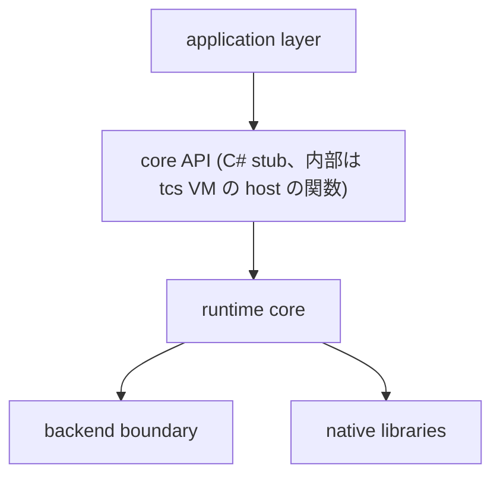

# lub Design

lub は、細部までこだわったゲーム体験を作るためのコード中心のゲームエンジンである。
最重要の価値は、ゲームを止めずに変更を反映し、トライアンドエラーを極限まで速くすること。

## Why

AI が自動生成する平均的な体験ではなく、人間が細部まで調整しきった体験を作れる環境がほしい。
そのためには、asset、描画、入力、物理、音、診断情報をコードから直接制御でき、変更が即座に動作へ反映される必要がある。

lub は GUI editor や特定 asset pipeline を中心に据えず、開発者が自分のゲームに必要なデータ構造と workflow をコードで組める余地を残す。

## To Be

- ゲームをコード中心に組み立てられる。
- 実行中のゲームを止めずに、コードや asset の変更を即座に反映できる。
- runtime 基盤は C/C++ と既存ライブラリを再利用し、移植性と native integration を保つ。
- ゲームは C# (TinyC#) だけで書く。tcs の出力 (tcs VM の bytecode) と runtime の間の層は内部の面で、利用者にも開発者にも開かない。
- 3D graphics を標準の描画基盤として持ち、2D game もその上で自然に扱える。
- core API は最小の固い primitive に絞る。
- core API の外側は C# の実装ライブラリ (`cs-lib/`) と app code が担う。lubx は C のライブラリが要るところだけ C の実装 (`src/lubx/`、stub の `namespace Lubx`) を持つ。

実行の層 (tcs VM) は、reload 時に data shape の変化へ追従しやすいことを重視する (設計は tcs の `doc/vm-design.md`)。
C# はその性質を活かしたまま、より書きやすい script authoring を提供するために使う。

script authoring layer は TinyC# ([tcs](https://github.com/neguse/tcs)、C# サブセットの compiler)。
全サンプルを C# で提供する (一覧の正は `web/playground/samples.ts` の CS_SAMPLES)。
web playground と native CLI (`lub <sample>/<Entry>.csproj`) は同じ DX (build + watch + hotswap) を持ち、player (tcs VM)・API 面 (生成した host の関数)・hot reload セマンティクスを共有する。
csproj は IDE 用の実プロジェクトでもあり、lub は basename (= entry class) と、印を付けた参照しか読まない。

C# のゲームは 3 つの経路で動く。
lub の player は tcs VM の player (tcs vm が作った bytecode を tcs VM で動かす、native と web。hotswap で動かす dev の経路で、`lub export` の snapshot もこれで動かす)。
tcs2c は tcs2c で C にしたゲームを lub と静的に link する経路 (Android の player など)。
.NET 実行は実 .NET が `dotnet/Lub` の facade から共有 library の C API を P/Invoke で叩く経路で、host は `App.Run(typeof(Game), args)`。
同じソースがどれでも通ることが契約で、CI は各サンプルをそれぞれ headless に回し、frame ごとの digest (C API 呼び出しの構造の hash) を突き合わせる。
数値は両方 f32 で、Math の超越関数も同じ実装 (次の段落) なので絵も揃い、手元の gate では capture 同士を byte 比較する。CI の契約は digest だけ。
golden 画像 (`tests/golden/<name>_<backend>.png`) は tcs VM の player で撮る。

ゲームの論理の計算は OS をまたいで決定的にする。数値は f32 で、四則演算と sqrt / floor / fmod などは IEEE-754 で結果が決まる。結果が実装で変わる超越関数 (sin / cos / tan / atan2 / exp / log / pow) は tcs が 1 つの実装 (`tcs/runtime/math`、三角関数系と log10 は CORE-MATH、exp / log / log2 / pow は musl の Arm 由来) を持つ。tcs2c の生成 C はそれを埋め込み、tcs VM は lub が link する同じ実装 (CMake の `tcs_runtime`) を呼び、.NET 実行は TinySystem.Math (同じ手順の C# 版) を呼ぶ。.NET の project は tcs の `TinySystem.props` を Import して、`Math` / `MathF` を TinySystem.Math にする。C のソースは FMA への融合などで結果が変わらないようにコンパイルを固定する。CI は決まった入力列の結果の hash を、Windows / Linux / macOS / iOS / web と tcs2c と .NET の経路で 1 つの期待値と比べる (`tests/cs/TestMathDeterminism.cs`。iOS は release の workflow で走る)。

## Non-Goals

- 既存 framework / engine の API 互換。
- 特定ゲームの元実装をそのまま載せるための alias や shortcut。
- 分業用 GUI authoring tool。
- 実行時 performance の最大化。大量 object や巨大 scene の処理は主目的ではない。
- AI ベース開発にしか役に立たない機能。
- WebGL fallback。web は WebGPU 必須とする。core API が compute / storage buffer を
  一級で持つため WebGL2 には収まらず、対応するなら core API のサブセット化という
  別の決断になる。WebGPU の無い環境 (古い iOS、Vulkan driver がブロックリストに
  載った Android の Chrome) は配布対象外
  (経緯: `docs/log/2026-07-07-backend-consolidation.md`)。
- マルチスレッド描画。thread ごとの command buffer、resource の所有の分割、pipeline cache の lock が要り、command queue が 1 本という今の前提を全面的に見直すことになる。

## Core API Boundary

lub core は、runtime が所有しなければ一貫性を保てない primitive だけを持つ。
それ以外は runtime API にしない。

core が所有するもの:

- 実行の境界: 起動、終了、frame、time step。
- 外部状態の snapshot: 入力や環境状態を frame 内で一貫して読むための境界。
- resource identity: resource の名前、寿命、version、reload の一貫性。
- backend abstraction: platform/backend 差分を core API へ漏らさないための command 境界。
- diagnostics: runtime 内部状態を観測し、再現と検証に使える情報。

core が所有しないもの:

- gameplay semantics。
- content semantics。
- application workflow。
- compatibility surface。
- authoring tools。

同じ処理が複数箇所で必要になっても、それだけでは core に入れない。
runtime invariant、resource lifetime、backend abstraction、hot reload、diagnostics のどれかを runtime が守る必要がある場合だけ core API として扱う。

### Script API 面

- 公式面は C# の stub (`cs-lib/lub_stub.cs` の namespace `Lub`、`Gfx` / `Input` / `Phys2d` / ...)。
- host の関数の名前 (`lub.gfx.begin_pass` / `lub.input.key_down` / ...) は、生成した tcs VM の host の関数 (`src/gen/vm_api_gen.c`) が登録し tcs の出力 (bytecode) が呼ぶ内部の面。名前は tcs の名前の規則と lub の間の取り決めで、両方を同じ変更の中で揃えて変える。

API の細かいシグネチャや binding の制約は、この文書ではなく記述側に置く。
一次情報は `cs-lib/lub_stub.cs`(C# の stub が API の記述)で、C API の header(`include/lub/lub_api.h`)と tcs VM の host の関数(`src/gen/vm_api_gen.c`)は `tools/lub-gen` がそこから生成する(`scripts/gen-api.sh`)。
C API の数値は int32_t / float で、C# の int / float に揃える。64 bit の値は面に出さない。

## Runtime Shape

`RenderBackend` vtable で backend 差分を閉じ込め、core API には漏らさない。
`pass.c` / `pipeline.c` / `resources.c` / `capture.c` は backend を呼び出す glue に留める。

`diag` は core API に置く。
log、capture、resource dump、runtime state dump のような情報取得は、人間の debug と自動検証の両方で必要になるため。

## Current Constraints

- backend は `d3d12` (Windows) / `vulkan` (Linux、Android、SDK が見つかる Windows) /
  `metal` (macOS / iOS) / `sdlgpu` (Windows / Linux の代替) / `webgpu`
  (web のみ)。未指定時の既定は Windows: d3d12、Linux: vulkan、
  macOS / iOS: metal、Android (Meta Quest): openxr (vulkan で OpenXR の headset に描く。`docs/android.md`)、web: webgpu。CI golden は Windows は WARP、Linux は
  lavapipe で回す (`docs/d3d12-backend.md`)。macOS と iOS simulator は
  runner の GPU で描き、Linux の golden と許容差で比べる
  (`docs/metal-backend.md`)。backend 構成の整理方針は
  `docs/log/2026-07-07-backend-consolidation.md`。
- iOS の player は shader compiler と transpiler を持たない。
  生成済みの bytecode (`.tcsb`) と shader cache を同梱した app として動く (`docs/metal-backend.md`)。
- swapchain capture (`--capture`) は native と web(golden 用)の両方にある。ゲームが任意の render target を読むのは `Gfx.Readback()`。
- SDL GPU path は combined image sampler 周辺に制約がある。
