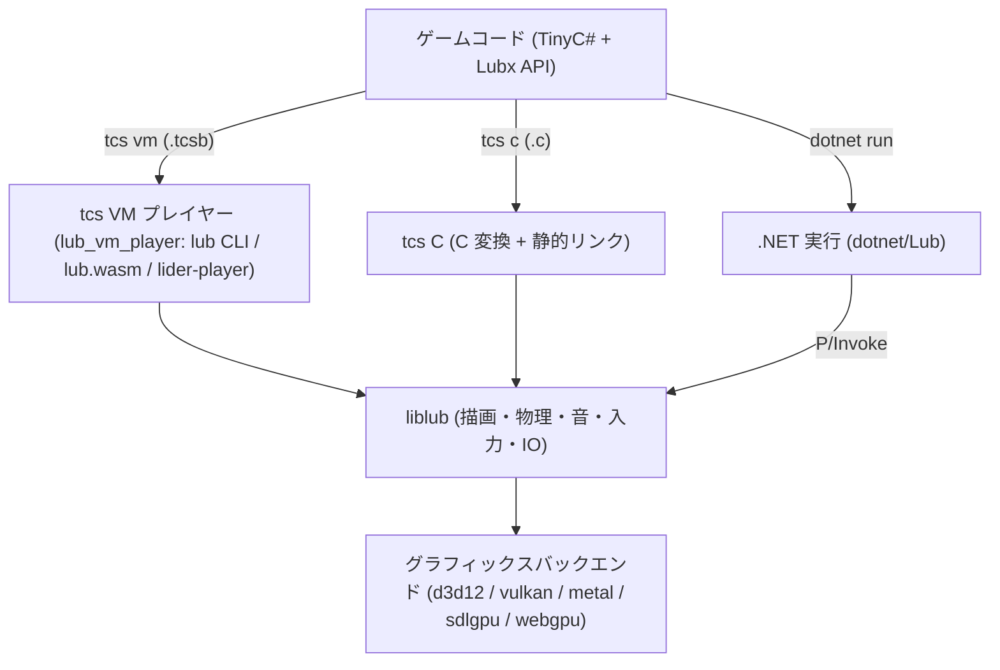

# 開発手順

## 構成

`lub` は以下の要素で構成される:

- `liblub` (ライブラリ): `Lub API` の C/C++ 実装ライブラリ (描画・物理・音・入力・IO・グラフィックスバックエンド)
- `player` (ライブラリ `lub_vm_player`): `liblub` と `tcs VM` でバイトコード (`.tcsb`) を動かす最小限の実行ライブラリ。`lub` CLI・`lider-player`・Web (`lub.wasm`)・外部 CMake プロジェクト (`find_package(lub)`) がリンクして使う
- `lub` CLI (実行ファイル): プレイヤーの起動と `check` / `export` を持つコマンドライン入口
- `tcs`: TinyC# コンパイラ (`tcs vm` / `tcs c`) と VM
- `Lub API` / `Lubx API`: API 定義の正本 (`cs-lib/lub_stub.cs`) と C# 便利層 (`cs-lib/`)
- `lider` / `web`: ホットリロード対応の専用エディタ (`lider-player` 上で動く TinyC# アプリ) と Web 配信ページ

TinyC# のゲームは、3 つの実行モード (`tcs VM` / `tcs C` / `.NET`) で共通の `liblub` を呼び出して動く。



| 場所 | 役割 |
| --- | --- |
| `src/`, `include/` | `liblub`、`player` (`lub_vm_player`)、`lub` CLI (`src/main.c`) |
| `cs-lib/` | `Lub API` の正本 (`lub_stub.cs`) と C# で書いた `Lubx API` (`lub/`, `lubx/`) |
| `tcs/` | TinyC# コンパイラ (`tcs vm` / `tcs c`)、VM、標準 C 補助 (`tcs/runtime/`) |
| `tools/lub-gen/` | `lub_stub.cs` から C ヘッダ・VM 連携・`.NET` facade・API docs を生成するツール |
| `dotnet/` | `.NET` 実行モード用の facade (`dotnet/Lub`) とテストランナー (`SampleRunner`) |
| `lider/` | ホットリロード対応の専用エディタ (自身も lub 上の TinyC# で動作) |
| `web/` | ブラウザ版 (`lub.neguse.net`) の配信ページ (lider / player / docs) |
| `samples/`, `templates/` | 動作サンプルとゲーム雛形 (`templates/game/`) |
| `tests/` | `lub` 本体のテスト一式 (`cs/`, `golden/`, `c/`, `vm/`, `dotnet/`, `cmake/`) |
| `scripts/`, `cmake/` | ビルド・検査・パッケージング用のスクリプトと CMake モジュール |
| `third_party/` | 外部依存 (SDL3、Box2D、Box3D、OpenXR、Slang、jamo 等) |

## 環境準備

必要なもの:
- 共通
    - CMake
    - Ninja
    - C11 / C++17 対応コンパイラ (GCC / Clang / MSVC)
    - .NET SDK
        - [dotnetup](https://learn.microsoft.com/dotnet/core/tools/dotnetup) `dotnetup sdk install`
- Linux
    - Vulkan loader と開発ヘッダ
        - Arch: `vulkan-icd-loader`
        - Debian/Ubuntu: `libvulkan-dev`

clone 後に一度、submodule の取得と commit フックの有効化を行う:

```sh
git submodule update --init
git config core.hooksPath .githooks
```

## ビルド

```sh
# Linux, macOS
cmake -S . -B build -G Ninja
cmake --build build -j
```

```powershell
# Windows (PowerShell, MSVC + Ninja)
& 'C:\Program Files\Microsoft Visual Studio\18\Professional\VC\Auxiliary\Build\vcvars64.bat'
cmake -S . -B build -G Ninja
cmake --build build -j
```

Release ビルドにする場合は configure 時に `-DCMAKE_BUILD_TYPE=Release` を付ける。

## フォーマットと検査

commit フックにより整形や lint が行われる。

```sh
# 手動で個別実行する場合
scripts/format.sh            # 全ソースを整形 (clang-format / dotnet format / prettier)
scripts/format.sh --check    # 整形確認のみ
scripts/docs-lint.sh         # bold・リンク切れ・docs/ パスを検査
scripts/gen-api.sh --check   # API 生成物が stub に追いついているか確認
```

## テスト

`lub` 本体のテストは `tests/` 配下に目的別で分かれている:

- `tests/cs/` — エンジン API の挙動テスト (C# で書き、`lub` と .NET の両方で動かして終了コードで判定)
- `tests/golden/` — 描画テスト (`tests/cs/` の一部) の正解画像
- `tests/c/` — C 内部モジュールの単体テスト (CMake の `lub_*_smoke` ターゲット)
- `tests/vm/` — ホットリロード・プロジェクト監視・拡張など player 周りの結合テスト (`scripts/vm-project-test.sh`)
- `tests/dotnet/` / `tests/cmake/` — .NET バインディングと外部 CMake 組み込みの検証

`tests/cs/` のテストは `<Entry>.cs` と 1 行の `<Entry>.csproj` で書き、判定には `tests/cs/Check.cs`、一覧は `scripts/cs-tests.sh` に置く。

```sh
./build/lub tests/cs/<Entry>.csproj        # tests/cs/ のテストを 1 本実行
BINARY=./build/lub scripts/run-golden.sh   # 描画テストを tests/golden と比較 (--update で再生成)
```

Linux で画面なし実行する場合は `scripts/run-headless.sh` を使う (lavapipe + xvfb / offscreen)。
一式をまとめて回すゲートスクリプトは `scripts/native-gate.sh` (Linux)、`scripts/apple-gate.sh` (macOS / iOS)、`scripts/pre-push.sh` (Linux + Web)。

GitHub ActionsのCIにより自動でテスト通過が確認される。

## API の追加と変更

API の正本は `cs-lib/lub_stub.cs` (`tools/lub-gen/Tool.cs` に規則と生成物一覧)。

1. `cs-lib/lub_stub.cs` に宣言と日本語 XML doc を追加・変更する
2. `scripts/gen-api.sh` で C ヘッダ・tcs VM host 関数・.NET facade・API docs を再生成する
3. `liblub` (`src/`) または `Lubx API` (`cs-lib/`) を実装する
