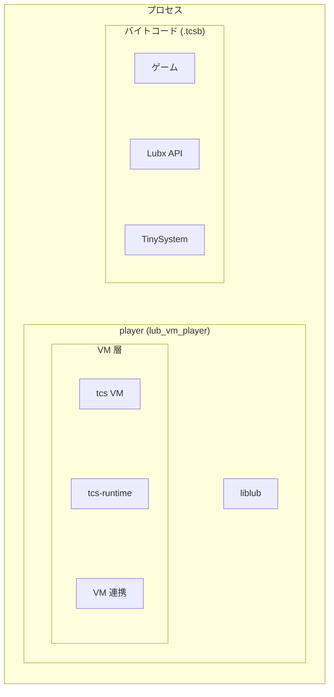
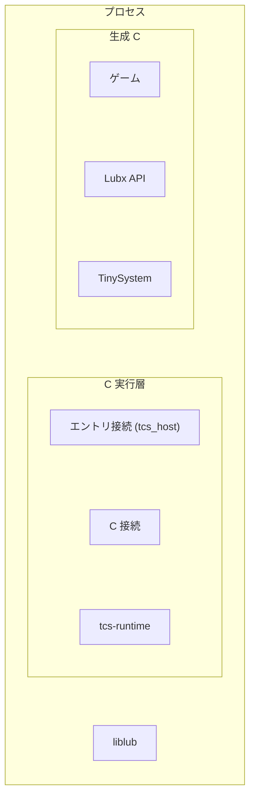
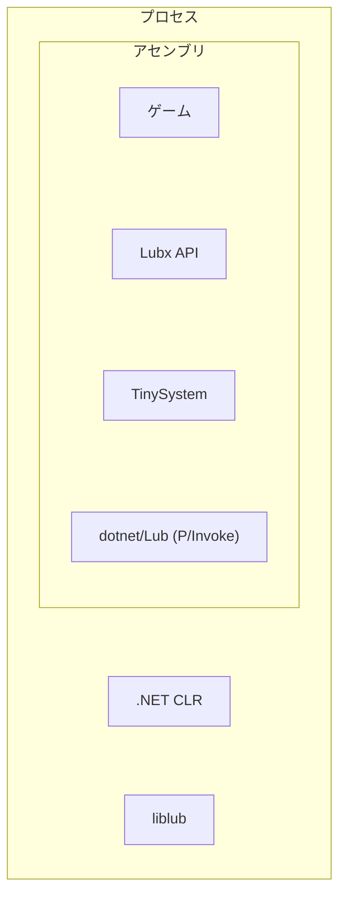

# 開発手順

## 構成

`lub` は以下の要素で構成される:

- `liblub` (ライブラリ): `Lub API` の C/C++ 実装ライブラリ (描画・物理・音・入力・IO・グラフィックスバックエンド)
- `player` (ライブラリ `lub_vm_player`): `liblub` と `tcs VM` でバイトコード (`.tcsb`) を動かす最小限の実行ライブラリ。`lub` CLI・`lider-player`・Web (`lub.wasm`)・外部 CMake プロジェクト (`find_package(lub)`) がリンクして使う
- `lub` CLI (実行ファイル): プレイヤーの起動と `check` / `export` を持つコマンドライン入口
- `tcs`: TinyC# コンパイラ (`tcs vm` / `tcs c`) と VM
- `Lub API` / `Lubx API`: API 定義の正本 (`cs-lib/lub_stub.cs`) と C# 便利層 (`cs-lib/`)
- `lider` / `web`: ホットリロード対応の専用エディタ (`lider-player` 上で動く TinyC# アプリ) と Web 配信ページ

### 実行モード

TinyC# のゲームは、用途に応じて 3 つの実行モードで共通の `liblub` 上に動く。

#### `tcs VM` モード

`tcs vm` でバイトコード (`.tcsb`) に変換し、`player` (`lub_vm_player`) 上で動かす。開発時のホットリロードに使う。



#### `tcs C` モード

`tcs c` で C コードに変換し、`liblub` と静的リンクして単一バイナリにする。実行性能を重視する配布ビルドに使う。



#### `.NET` モード

実 `.NET` 上で動かし、共有ライブラリ `liblub` を P/Invoke で呼ぶ。`.NET` のエコシステムを利用したいとき、および `tcs VM` / `tcs C` の実行結果を本家 C# と比較する検証に使う。



| 場所 | 役割 |
| --- | --- |
| `src/`, `include/` | `liblub`、`player` (`lub_vm_player`)、`lub` CLI (`src/main.c`) |
| `src/tcs/` | TinyC# コンパイラ (`tcs vm` / `tcs c`)。.NET では `tcs.dll`、C では `tcs` |
| `src/tcs-vm/` | tcs VM |
| `src/tcs-runtime/` | 標準 C 補助 (tcs VM と `tcs c` の出力が使う) |
| `src/tcs-system/` | `TinySystem` (.NET で動かすときの型と、source で配る LINQ) |
| `src/tcs-analyzers/` | IDE と `dotnet build` に TinyC# の診断を出す analyzer |
| `src/tcs-format/` | サイトが C# を整形する wasm |
| `tests/tcs/`, `tests/tcs-backends/`, `tests/tcs-vm/`, `tests/tcs-analyzers/`, `tests/tcs-perf/` | tcs のテストと性能の計測 (ランナーの label `tcs` が全部を回す) |
| `cs-lib/` | `Lub API` の正本 (`lub_stub.cs`) と C# で書いた `Lubx API` (`lub/`, `lubx/`) |
| `tools/lub-gen/` | `lub_stub.cs` から C ヘッダ・VM 連携・`.NET` facade・API docs を生成するツール |
| `dotnet/` | `.NET` 実行モード用の facade (`dotnet/Lub`) とテストランナー (`SampleRunner`) |
| `lider/` | ホットリロード対応の専用エディタ (自身も lub 上の TinyC# で動作) |
| `web/` | ブラウザ版 (`lub.neguse.net`) の配信ページ (lider / player / docs) |
| `samples/`, `templates/` | 動作サンプルとゲーム雛形 (`templates/game/`) |
| `tests/` | `lub` 本体のテスト一式 (`cs/`, `golden/`, `c/`, `vm/`, `dotnet/`, `cmake/`) |
| `scripts/`, `cmake/` | ビルド・検査・パッケージング用のスクリプトと CMake モジュール |
| `third_party/` | 外部依存 (SDL3、Box2D、Box3D、OpenXR、Slang、jamo 等) |

## 環境準備

必要なもの:
- 共通
    - CMake
    - Ninja
    - C11 / C++17 対応コンパイラ (GCC / Clang / MSVC)
    - .NET SDK
        - [dotnetup](https://learn.microsoft.com/dotnet/core/tools/dotnetup) `dotnetup sdk install`
- Linux
    - Vulkan loader と開発ヘッダ
        - Arch: `vulkan-icd-loader`
        - Debian/Ubuntu: `libvulkan-dev`

clone 後に一度、submodule の取得と commit フックの有効化を行う:

```sh
git submodule update --init
git config core.hooksPath .githooks
```

## ビルド

```sh
# Windows + Visual Studio の場合
& 'C:\Program Files\Microsoft Visual Studio\18\Professional\VC\Auxiliary\Build\vcvars64.bat'
cmake -S . -B build -G Ninja
cmake --build build -j
```

Release ビルドにする場合は configure 時に `-DCMAKE_BUILD_TYPE=Release` を付ける。

## フォーマットと検査

commit フックにより整形や lint が行われる。

```sh
# 手動で個別実行する場合
scripts/format.sh            # 全ソースを整形 (clang-format / dotnet format / prettier)
scripts/format.sh --check    # 整形確認のみ
scripts/docs-lint.sh         # bold・リンク切れ・docs/ パスを検査
scripts/gen-api.sh --check   # API 生成物が stub に追いついているか確認
```

## テスト

テストは `tests/` の下に目的別に分かれている。

- `tests/cs/` — エンジン API の挙動テスト (C# で書き、`lub` と .NET の両方で動かして終了コードで判定)
- `tests/golden/` — 描画テスト (`tests/cs/` の一部) の正解画像
- `tests/c/` — C 内部モジュールの単体テスト (CMake の `lub_*_smoke` ターゲット)
- `tests/vm/` — ホットリロード・プロジェクト監視・拡張など player 周りの結合テスト
- `tests/dotnet/` / `tests/cmake/` — .NET バインディングと外部 CMake 組み込みの検証
- `tests/tcs*/` — tcs 自身のテスト
- `tests/lub-test/` — テストを走らせるランナー

`tests/cs/` のテストは `<Entry>.cs` と 1 行の `<Entry>.csproj` で書き、判定には `tests/cs/Check.cs`、一覧は `tests/cs/tests.json` に置く。

テストは全部、ランナー (`tests/lub-test`) から走らせる。
ランナーは、どのテストを、どの OS の、どの backend で走らせるかの宣言 (`tests/lub-test/Tests/`) を 1 か所に持ち、並列、timeout、絞り込み、分割、画面なしでの起動を受け持つ。
lub の build は先に済ませておく (`scripts/build-release.sh`)。dotnet は必須。

```sh
dotnet run --project tests/lub-test -- --list                    # テストの一覧と label
dotnet run --project tests/lub-test --                           # 全部
dotnet run --project tests/lub-test -- --label cs                # label で選ぶ (smoke、cs、golden、tools、bindings、vm、lider、tcs など)
dotnet run --project tests/lub-test -- --name TestFixedDt        # 名前の正規表現で選ぶ
dotnet run --project tests/lub-test -- --label golden --update-goldens   # 正解画像を作り直す
dotnet run --project tests/lub-test -- --label fuzz --fuzz-count 500     # 長い fuzz (全部を回すときには走らない)
./build/lub tests/cs/<Entry>.csproj                              # tests/cs/ のテストを 1 本、手で実行
```

ほかの option (`--skip-label`、`--shard`、`--jobs`、`--build`、`--logs`) は `tests/lub-test/Program.cs` の先頭にある。
失敗したテストは、出力と、作った file の置き場所を表示する。

ランナーは bash の script を起動しない。画面なしでの起動、tcs の呼び出し、生成物の比較は全部 C# で持つ。
画面なしで 1 本だけ動かすときは `dotnet run --project tests/lub-test -- headless ./build/lub <args>` を使う (Linux は lavapipe + xvfb / offscreen)。
lider の player (`lider/scripts/build-player.sh`)、C の tcs (`scripts/build-tcs-native.sh`)、C の lub-gen (`scripts/build-lub-gen.sh`) も、lub の build と同じく先に作っておく。
iOS の simulator のテストはランナーの `--label ios` (macOS で、`scripts/build-ios.sh` の後に走らせる)、web の page のテストは `web/README.md`、Linux と web をまとめて回すのは `scripts/pre-push.sh`。

GitHub ActionsのCIにより自動でテスト通過が確認される。

## API の追加と変更

API の正本は `cs-lib/lub_stub.cs` (`tools/lub-gen/Tool.cs` に規則と生成物一覧)。

1. `cs-lib/lub_stub.cs` に宣言と日本語 XML doc を追加・変更する
2. `scripts/gen-api.sh` で C ヘッダ・tcs VM host 関数・.NET facade・API docs を再生成する
3. `liblub` (`src/`) または `Lubx API` (`cs-lib/`) を実装する
